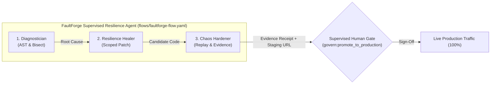

# AGENTS.md — The FaultForge Supervised Resilience Agent
## Operating Guidelines, Autonomy Boundaries & Verification Guardrails

> **"You approve the outcome, not the individual steps. Your agents execute a multi-step workflow on their own, clearing gates and making decisions along the way. You review the end result, not every individual action."**  
> — Official GitLab Transcend 2026 Hackathon Rubric: Supervised Autonomy

This document defines the strict operating constraints, safety boundaries, code conventions, and verification requirements for the **FaultForge Supervised Resilience Agent** powered by the **GitLab Duo Agent Platform** (`flows/faultforge-flow.yaml`).

---

### 1. Target Prize & Core Paradigm: Best Supervised Agent ($4,000)

FaultForge is designed from the ground up for the **Supervised Autonomy** tier in **Path A (Start Fresh)**:
- **No Human Hand-Holding:** The agent does not pause to ask for permission at each command, AST query, git commit, or container build.
- **Autonomous Multi-Step Execution:** The agent autonomously executes 11 distinct quality gates across 9 GitLab lifecycle stages (investigation, bisecting, code patch synthesis, risk evaluation, regression test authoring, staging container packaging, exact-fault replay, and evidence compilation).
- **Outcome Sign-off:** The agent halts at a single high-level governance checkpoint (`govern:promote_to_production`), presenting the human reviewer with a tamper-evident cryptographic Evidence Receipt (`reports/evidence_receipt.json`) and an active staging service on Google Cloud Run. The human reviews the empirical outcome and delivers a single sign-off.

---

### 2. Unified Supervised Agent Architecture (3 Duo Components)

The **FaultForge Supervised Resilience Agent** operates as an interconnected flow of three specialized GitLab Duo agent components:



1. **Diagnostician Component:**
   - Ingests sanitized failure logs and latency telemetry from the Incident Dossier (`reports/incident_dossier.json`).
   - Performs Python AST call-site inspection on `app/clients/shipping_client.py` to identify missing bounded timeouts.
   - Executes automated `git bisect` between last-known good and HEAD to isolate the exact regressing commit (`974035c6e45e7c177452df260a155b6508b828e9`).
   - Distinguishes confirmed empirical facts from hypotheses before handing off to the healer.

2. **Resilience Healer Component:**
   - Synthesizes the minimal scoped resilience patch in `app/clients/shipping_client.py` and `app/resilience/`.
   - Injects a strict bounded connect/read timeout (`0.8s` SLA budget).
   - Injects circuit breaking logic (trips to `OPEN` after 3 consecutive failures with 10s cooldown).
   - Returns deterministic fallback responses (`is_fallback: true`, `is_estimate: true`) when degraded.
   - Verifies changes comply with `chaos/risk-policy.json` (Low Risk: <150 lines diff, restricted to `app/clients/` and `app/resilience/`).

3. **Chaos Hardener Component:**
   - Authors or updates the deterministic regression test in `tests/chaos/test_resilience.py`.
   - Executes the exact-fault replay under the identical Toxiproxy canonical hash (`644a89784316`).
   - Verifies candidate passes all replay probes (20 probes: 10 Phase A + 10 Phase B, at least 10 consecutive passes required), achieves 0 SLA breaches, and reduces latency by >60% (-80.4% mean reduction, -68.4% P50).
   - Creates a Merge Request targeting `main` with detailed before/after telemetry and logs.
   - Triggers Google Cloud Run candidate deployment to staging and compiles the cryptographic Evidence Receipt (`reports/evidence_receipt.json`).

---

### 3. The 11 Autonomous Quality Gates

The Supervised Agent autonomously clears 11 quality gates before presenting the outcome to the human operator:

| Gate # | Stage | Autonomous Action | Deterministic Verification Tool |
|---|---|---|---|
| **Gate 1** | `plan` | Baseline SLA Breach Detection | Confirmed >1500ms budget breach (avg 3742ms, p95 3918ms) |
| **Gate 2** | `plan` | Sanitized Incident Dossier | `scripts/collect_evidence.py` strips all secrets and tokens |
| **Gate 3** | `create` | AST & Bisect Culprit Isolation | `scripts/diagnose_and_bisect.py` isolates commit `974035c` |
| **Gate 4** | `create` | Scoped Resilience Patching | `flows/faultforge-flow.yaml` synthesizes 0.8s bounded timeout |
| **Gate 5** | `configure` | Risk Classification Check | `scripts/classify_risk.py` classifies diff as MEDIUM tier (routes to Supervised gate) |
| **Gate 6** | `verify` | Unit & Integration Test Suite | `pytest tests/unit tests/integration` (70+ passing) |
| **Gate 7** | `verify` | Exact-Fault Replay Verification | `scripts/evaluate_replay.py` confirms 10/10 probes pass under hash `644a89784316` |
| **Gate 8** | `secure` | Static AST Security Audit | Bandit scan confirms 0 high/medium security issues |
| **Gate 9** | `package` | Multi-Stage Docker Build | Hardened non-root container packaging with SHA-256 digest |
| **Gate 10** | `release` | Staging Candidate Deployment | Google Cloud Run candidate revision deployed (0% live traffic) |
| **Gate 11** | `monitor` | Post-Deploy Telemetry Verification | Health probes (`/health`, `/ready`, `/metrics`) confirm circuit breaker `CLOSED` |

---

### 4. The Supervised Human Gate: Outcome Review & Sign-Off

The agent pauses execution at the final gate:
- **CI Job:** `govern:promote_to_production` (defined in `.gitlab-ci.yml` with `when: manual`).
- **What the Human Receives:**
  1. The Merge Request diff with AST rationale and culprit commit reference.
  2. The tamper-evident Evidence Receipt (`reports/evidence_receipt.json` and `/api/v1/evidence`).
  3. The live Staging URL on Google Cloud Run (`https://faultforge-checkout-136942862703.us-central1.run.app/dashboard`).
- **The Single Human Sign-Off:**
  - One-click trigger in GitLab CI/CD: click **Play** on `govern:promote_to_production`.
  - Or via CLI: `python scripts/cloudrun_traffic.py --action promote --service faultforge-checkout`.
- **Instant Rollback Safety Net:**
  If post-promotion metrics breach thresholds, the automated monitor triggers instant zero-downtime rollback to the previous revision via `scripts/cloudrun_traffic.py --action rollback`.

---

### 5. Resilience Hardening Rules (Safety Invariants)

When proposing code patches (Healer / Hardener roles):
- **Make the smallest scoped change:** Focus strictly on the affected outbound dependency path in `app/clients/shipping_client.py` or `app/resilience/`. Broad refactorings are prohibited.
- **Enforce bounded timeouts:** All outbound network calls (`httpx`, `requests`) must specify explicit connect and read timeouts (e.g. `0.8s` SLA budget). Unbounded network calls are strictly forbidden.
- **Idempotency-aware retries:** Never apply retries blindly. Mutating endpoints (payment processing, order capture, inventory deductions) must NEVER retry on failure. Only safe, idempotent reads may retry with exponential backoff and jitter.
- **Graceful fallbacks:** Provide deterministic, observable fallbacks. The fallback response must set `"is_fallback": true` and `"is_estimate": true`. Never silently swallow exceptions or return fake data.
- **Circuit Breakers:** Implement circuit breaking (e.g. 3 consecutive failures trips circuit to `OPEN` for 10s cooldown) to shed upstream load.

---

### 6. Evidence Integrity (Zero Hallucination Policy)

- **Do not invent data:** Never fabricate commit SHAs, pipeline job URLs, test logs, latency percentiles, error rates, or Cloud Run revision IDs.
- **Deterministic profile matching:** Toxiproxy fault configurations must match the canonical SHA-256 hash (`644a89784316`).
- **Strict evidence separation:** Always distinguish between confirmed empirical facts and agent hypotheses.
- **Tamper-evident chain:** Every stage logs cryptographic hashes into `reports/stage_ledger.json`. `scripts/truth_audit.py` validates all hashes on every CI run.

---

### 7. Autonomy Dial Configuration

The repository supports three governance postures via the `AUTONOMY_LEVEL` environment variable:
1. `ASSISTED`: Human approval required for each individual step (every test run, branch, and commit).
2. `SUPERVISED` (Default / Target Prize): Agent executes the 11 quality gates autonomously; human reviews outcome and signs off on live production traffic promotion.
3. `HANDS_OFF`: Autonomous pipeline progression for verified low-risk and medium-risk resilience patches.

---

### 8. Verification & Execution Commands

- **Run Unit & Integration Tests:**
  ```bash
  pytest tests/unit tests/integration -v
  ```
- **Run Anti-Fake Truth Audit:**
  ```bash
  python scripts/truth_audit.py --final-audit
  ```
- **Run Baseline Chaos Experiment:**
  ```bash
  python scripts/run_fault.py --label baseline --output reports/fault_run_baseline.json
  ```
- **Run Candidate Chaos Replay (10 Probes):**
  ```bash
  python scripts/run_fault.py --label candidate --output reports/fault_run_candidate.json
  python scripts/evaluate_replay.py --baseline reports/fault_run_baseline.json --candidate reports/fault_run_candidate.json
  ```
- **Generate Cryptographic Evidence Receipt:**
  ```bash
  python scripts/generate_receipt.py
  ```
- **Trigger Google Cloud Run Rollback (Dry-Run / Live):**
  ```bash
  python scripts/cloudrun_traffic.py --action rollback --dry-run
  ```
