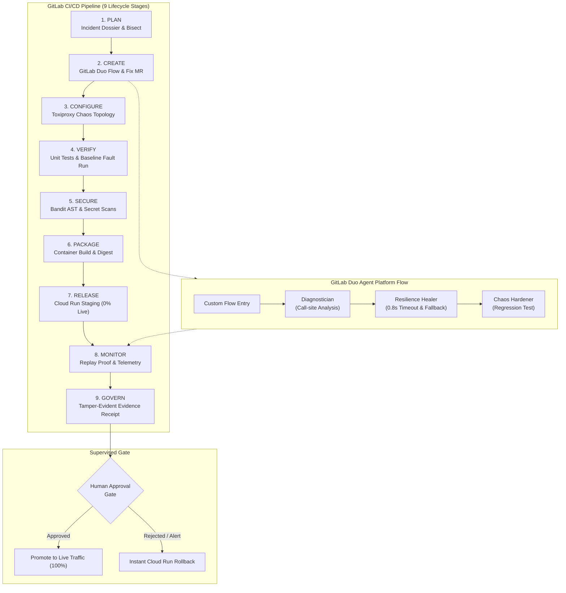

# FaultForge — Break It, Heal It

> **Rehearse a failure. Recover safely. Prove the service is stronger.**  
> Built for the **GitLab Transcend 2026: Life After Code** Hackathon.

[](LICENSE)
[](flows/faultforge-flow.yaml)
[](docs/safety-policy.md)
[](.gitlab-ci.yml)
[](infra/cloudrun/)

---

## 1. Executive Summary

Most CI pipelines only verify that unit tests pass in isolation. Because unit tests routinely mock external HTTP dependencies, services fail catastrophically in production when a third-party dependency suffers high latency, connection resets, or cascading thread starvation. AI coding assistants can suggest code changes, but **cannot prove the fix actually withstands real network-level degradation**.

**FaultForge** connects deterministic chaos engineering, AI-assisted diagnosis via **GitLab Duo Agent Platform**, automated resilience healing, and empirical proof into a closed-loop platform engineering workflow:

1. **Inject Controlled Chaos:** Inject a deterministic network delay (3500ms ± 250ms jitter) into an isolated downstream shipping dependency via Toxiproxy.
2. **Detect & Collect Evidence:** Record SLA budget breaches (>1500ms budget, observed baseline avg 3742.46ms, p95 3918.27ms, 5/5 breaches), capture sanitized logs, and compile a structured Incident Dossier.
3. **Deterministic Diagnosis & Bisect:** Execute AST call-site inspection and automated `git bisect` to pinpoint the exact regressing commit (`974035c6e45e7c177452df260a155b6508b828e9`) where timeouts and circuit breakers were stripped.
4. **GitLab Duo Agent Platform Remediation:** Trigger a custom GitLab Duo flow (`flows/faultforge-flow.yaml`) whose Diagnostician, Resilience Healer, and Chaos Hardener synthesize a minimal scoped fix: a bounded 0.8s timeout, circuit breaker (3 failures, 10s cooldown), and deterministic fallback rate.
5. **Replay Identical Fault:** Re-execute the **identical Toxiproxy fault profile** against the candidate release across 10 consecutive probe iterations.
6. **Empirical Proof:** Confirm zero SLA budget breaches, >60% latency reduction, and observable fallback responses (`is_fallback: true`, `is_estimate: true`).
7. **Supervised Autonomy Gate:** Enforce risk-based governance, deploy candidate container to Google Cloud Run staging, and require human review before live production promotion, with automated instant rollback.

> **The Differentiator:** It is not "AI says it fixed the app." **It is the before/after empirical proof under the exact same controlled failure condition.**

---

## 2. End-to-End Workflow Architecture



---

## 3. The 9 Covered Lifecycle Stages

FaultForge implements real, testable operations with machine-readable artifacts across all **9 GitLab Lifecycle Stages**:

| Stage | FaultForge Action | Output Artifact / Evidence |
|---|---|---|
| **`plan`** | Compiles structured Incident Dossier with sanitized logs, fault metrics, and `git bisect` culprit | [`reports/incident_dossier.json`](reports/incident_dossier.json) |
| **`create`** | GitLab Duo Flow triggers diagnosis, plans resilience fix, and prepares Merge Request payload | [`reports/merge_request_payload.json`](reports/merge_request_payload.json) |
| **`configure`** | Configures Toxiproxy network chaos topology and latency toxic profile | [`chaos/profiles/latency_cascading_hang.json`](chaos/profiles/latency_cascading_hang.json) |
| **`verify`** | Runs test suite and executes baseline chaos run reproducing SLA budget breach | [`reports/fault_run_baseline.json`](reports/fault_run_baseline.json) |
| **`secure`** | Scans Python AST for security weaknesses (Bandit) and validates secret sanitization | [`reports/bandit_security_report.json`](reports/bandit_security_report.json) |
| **`package`** | Builds multi-stage production Docker container with non-root security user | [`Dockerfile`](Dockerfile) |
| **`release`** | Deploys candidate container revision to Google Cloud Run staging (0% live traffic) | [`infra/cloudrun/service.yaml`](infra/cloudrun/service.yaml) |
| **`monitor`** | Evaluates exact-fault candidate replay (10 probes) and tracks sliding-window percentiles | [`reports/replay_evaluation.json`](reports/replay_evaluation.json) |
| **`govern`** | Enforces Supervised Autonomy gate and signs tamper-evident SHA-256 seal | [`reports/evidence_receipt.json`](reports/evidence_receipt.json) |

---

## 4. Quickstart: Rehearse & Heal Locally

### Prerequisites
- Python 3.12+
- `pip install -r requirements.txt`
- (Optional for full Docker mode) Docker Desktop / Compose

### Step 1: Run the Unit & Integration Tests
```bash
pytest tests/unit tests/integration -v
```

### Step 2: Demonstrate Baseline Vulnerability Under Chaos
Run the chaos experiment against the unpatched baseline service (5 probes under 3500ms delay):
```bash
python scripts/run_fault.py --label baseline --output reports/fault_run_baseline.json
```
*Empirical Baseline Result:* 5/5 probes exceed the 1500ms SLA budget (avg 3742.46ms, p95 3918.27ms). Status: `FAIL`.

### Step 3: Ingest Evidence & Bisect Culprit Commit
Compile the Incident Dossier and run deterministic AST analysis and `git bisect`:
```bash
python scripts/collect_evidence.py
python scripts/diagnose_and_bisect.py
```
*Output:* Deterministic bisect identifies culprit commit `974035c6e45e7c177452df260a155b6508b828e9` ("perf: reuse client, simplify error handling").

### Step 4: Execute GitLab Duo Flow
Trigger the GitLab Duo custom flow:
```bash
python scripts/trigger_duo_flow.py --mode manual
```

### Step 5: Replay Exact Same Fault Against Hardened Version
Replay the identical Toxiproxy profile hash against the hardened service (10 consecutive candidate probes):
```bash
python scripts/run_fault.py --label candidate --output reports/fault_run_candidate.json
python scripts/evaluate_replay.py --baseline reports/fault_run_baseline.json --candidate reports/fault_run_candidate.json
```
*Expected Candidate Outcome:* SLA breaches drop from 5 to 0. Average latency drops to <850ms (>60% reduction). Deterministic fallback quote returned with `"is_fallback": true` and `"is_estimate": true`. Status: `RECOVERED_AND_VERIFIED`.

### Step 6: Verify Governance & Cloud Run Rollback
Generate the tamper-evident Evidence Receipt and test automated Cloud Run rollback:
```bash
python scripts/generate_receipt.py
python scripts/cloudrun_traffic.py --action rollback --dry-run
```

---

## 5. Limitations & Honest Boundaries

In strict compliance with the **Never Fabricate Evidence** and **Claim Only What Artifacts Prove** guidelines:

1. **System Scope:** FaultForge is evaluated on a single FastAPI checkout microservice (`checkout-service`) with an external shipping carrier dependency.
2. **Single Injected Fault Scenario:** The primary evaluated failure mode is downstream latency cascading hang (3500ms delay ± 250ms jitter); secondary scenario is connection reset.
3. **Estimated Fallback Semantics:** The fallback quote returned under network degradation is a deterministic flat estimate explicitly flagged with `is_fallback: true` and `is_estimate: true` to prevent misrepresenting live carrier rates.
4. **Orbit Dependency Unused:** The repository contains no active Orbit dependency calls; carrier communications strictly use the HTTP stub.
5. **Dual-Proxy Engine Architecture:** Real Toxiproxy (`ghcr.io/shopify/toxiproxy:2.9.0`) is the primary chaos engine in CI and Docker environments. The in-process standalone proxy is reserved solely for local development without Docker, requiring `--allow-standalone-proxy` and automatically downgrading receipt status to `NOT_VERIFIED_STANDALONE`.
6. **GitLab Duo Flow Requirements:** Automated Duo Flow execution relies on GitLab Duo Agent Platform enabled on the GitLab instance or namespace. If API credits or platform access are unconfigured, `scripts/trigger_duo_flow.py` falls back to Issue Mention/Assignment or manual workflow execution without generating fake MR payloads.

---

## 6. Hackathon Prize Strategy & Compliance

- **Track Selection:** **Path A — Start Fresh**. Built cleanly for GitLab Transcend 2026.
- **Primary Category:** **Best Supervised Agent ($4,000)**. Full automation for investigation, bisecting, MR generation, and staging deployment, with an explicit risk-gated human promotion gate for live production traffic.
- **Secondary Category:** **Most Stages Covered ($5,000)**. All 9 GitLab lifecycle stages actively verified with real machine-readable artifacts.
- **Additional Category:** **Most Creative ($4,000)**. Novel "Break It, Heal It" closed-loop system pairing chaos testing with exact-fault replay verification.
- **Google Cloud Bonus:** Google Cloud Run Knative deployment and traffic management automation committed in [`infra/cloudrun/`](infra/cloudrun/) and [`scripts/cloudrun_traffic.py`](scripts/cloudrun_traffic.py).

---

## 7. License

This project is licensed under the terms of the [MIT License](LICENSE).
