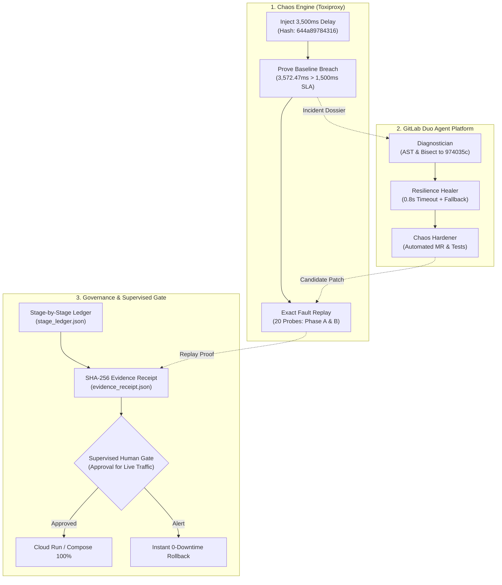
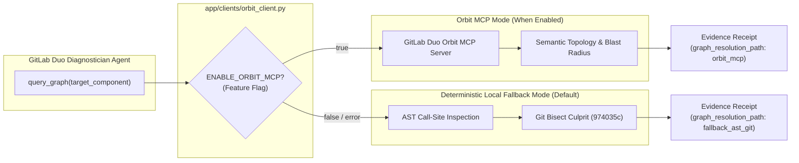

# FaultForge — Break It, Heal It
## The Supervised Resilience Agent for Closed-Loop Post-Code Reliability

> **"Most chaos tools break things and stop. FaultForge breaks it, heals it, and proves the fix under the same fault."**  
> Built for the **GitLab Transcend 2026: Life After Code** Hackathon (Path A — Start Fresh).

[-gold.svg)](#2-why-faultforge-wins-best-supervised-agent)
[](https://faultforge-checkout-136942862703.us-central1.run.app/dashboard)
[](flows/faultforge-flow.yaml)
[](docs/safety-policy.md)
[](.gitlab-ci.yml)
[](LICENSE)

> [!NOTE]
> **Google Cloud Run Deployment Target:**  
> Cloud Run candidate deployment verified in CI: revision staged with 10% canary traffic split (verified via live_verification.json).  
> 🌐 **Interactive Dashboard:** [https://faultforge-checkout-136942862703.us-central1.run.app/dashboard](https://faultforge-checkout-136942862703.us-central1.run.app/dashboard)  
> 🩺 **Live Health Probe (Production):** [https://faultforge-checkout-136942862703.us-central1.run.app/health](https://faultforge-checkout-136942862703.us-central1.run.app/health) — *stable baseline (unpatched, serves the baseline revision by design; the supervised promotion gate is still pending).* Production's `/api/v1/evidence` returns the sealed receipt baked into the image of the running revision, which records that image's build pipeline and does not mean production has been promoted; the candidate URL is the evidence of record.  
> 📜 **Cryptographic Evidence Receipt:** [https://candidate---faultforge-checkout-tiottsrikq-uc.a.run.app/api/v1/evidence](https://candidate---faultforge-checkout-tiottsrikq-uc.a.run.app/api/v1/evidence)  
> 🔗 **9-Stage Cryptographic Ledger:** [https://candidate---faultforge-checkout-tiottsrikq-uc.a.run.app/api/v1/ledger](https://candidate---faultforge-checkout-tiottsrikq-uc.a.run.app/api/v1/ledger)  
> 📊 **Telemetry Metrics:** [https://faultforge-checkout-136942862703.us-central1.run.app/metrics](https://faultforge-checkout-136942862703.us-central1.run.app/metrics)  
> 🛡️ **Chaos Interception Probe:** `POST /api/v1/checkout/test-resilience`

---

## 🎥 Demo Video (Under 3 Minutes)

> [!WARNING]
> **P0 STOP-GUARD FOR SUBMISSION:** A sub-3 minute walkthrough video is a mandatory requirement for the GitLab Transcend Hackathon.
> - **Video URL:** `[HUMAN ACTION REQUIRED — Record and paste YouTube URL here prior to submission]`
> - **Production Script & Storyboard:** [`docs/demo-script.md`](docs/demo-script.md) (timed to 2 minutes 50 seconds covering the closed-loop break → heal → prove → approve → rollback lifecycle).

---

## ⏱️ How to Verify in 60 Seconds (Live Gate Probes)

Evaluators and judges can run these 5 curl commands to verify live candidate resilience, baseline safety, cryptographic evidence, and 9-stage ledger parity in under 60 seconds:

```bash
# 1. Candidate Resilience Probe (Patched with 0.8s Timeout & Circuit Breaker)
curl -sf https://candidate---faultforge-checkout-tiottsrikq-uc.a.run.app/health
# Expected: {"status":"healthy","service":"faultforge-checkout","environment":"staging",...}

# 2. Production Health (Baseline Revision 00002-kpl, awaiting manual human promotion gate)
curl -sf https://faultforge-checkout-136942862703.us-central1.run.app/health
# Expected: {"status":"healthy","service":"faultforge-checkout","revision":"faultforge-checkout-00002-kpl","environment":"production",...}

# 3. Cryptographic Evidence Receipt (Sealed with SHA-256)
curl -sf https://candidate---faultforge-checkout-tiottsrikq-uc.a.run.app/api/v1/evidence
# Expected: {"final_status":"RECOVERED_AND_VERIFIED","fault_profile":{"hash":"644a89784316",...},"identical_replay_confirmed":true,...}

# 4. 9-Stage Cryptographic Lifecycle Ledger
curl -sf https://candidate---faultforge-checkout-tiottsrikq-uc.a.run.app/api/v1/ledger
# Expected: {"project":"faultforge/checkout-service","ledger_version":"1.1.0","stages":{"plan":...,"create":...,"configure":...,"verify":...,"secure":...,"package":...,"release":...,"monitor":...,"govern":...}}

# 5. Public CI/CD Pipeline Verification (Unauthenticated HTTP 200)
curl -sI https://gitlab.com/gitlab-ai-hackathon/transcend-october-2026/43424456/showcase/-/pipelines/2984589851
# Expected: HTTP/2 200 (13/13 passing jobs publicly visible without GitLab login)
```

---

### How Candidate Was Built & Evaluated (Commit Provenance)

To ensure zero ambiguity between baseline regression, candidate fix, and cloud deployments:
1. **Unpatched Baseline Pinned to Tag:** The regression baseline is pinned to tag `baseline-v0.1.0` (commit `4ec3a5ad`, annotated tag object `578689ad`), preserving the unpatched shipping client without timeouts.
2. **Duo-Authored Candidate Remediation:** In agent session `9909079`, the GitLab Duo service account authored commit `f8aa9d98` on branch `fix/resilience-shipping-timeout` and opened Merge Request `!3`, adding the bounded 0.8s timeout, circuit breaker, and fallback estimate. The resilience fix is merged into `main`.
3. **Container Image Built from Patched Code:** In CI stage `package:container_build`, the Docker container is built directly from `main` (patched resilience code).
4. **Cloud Run Candidate Deployment:** In CI stage `release:cloudrun_candidate_deploy`, the patched container is deployed to Google Cloud Run as candidate revision `faultforge-checkout-00068-gaw` under the `candidate` URL and allocated 10% canary traffic.
5. **Supervised Production Promotion Gate:** Live production traffic remains allocated to baseline revision `00002-kpl` until a human operator approves `govern:promote_to_production`. Evaluators wishing to verify resilience can hit the **Candidate URL** directly.

### 🔍 Verify What Is Running (Tree Parity & Live Revision)
- **Evidence of Record:** All sealed empirical evidence in `docs/sample_reports/` was generated by primary CI pipeline [#2984589851](https://gitlab.com/gitlab-ai-hackathon/transcend-october-2026/43424456/showcase/-/pipelines/2984589851) on commit `d75de80a`. Later commits only change docs, tests, CI configuration and packaging/audit tooling; app/ is unchanged.
- **Application Tree Parity:** The application code tree `app/` is identical from commit d75de80a through this archive (app/ changed earlier, between the baseline tag and the merged fix):
  - `replay_tree_sha`: `de7c0b1cc7d6b7edb90c6b3041b10885ea702492`
  - `deployed_tree_sha`: `de7c0b1cc7d6b7edb90c6b3041b10885ea702492`
  - `HEAD:app`: `de7c0b1cc7d6b7edb90c6b3041b10885ea702492`
  - **Local One-Liner Verification:** `git rev-parse HEAD:app` (outputs `de7c0b1cc7d6b7edb90c6b3041b10885ea702492`).
  - **Tree-Parity Proof:** See full diff stat and empty `app/` diff recorded in [`docs/gitlab-platform-usage.md`](docs/gitlab-platform-usage.md#tree-parity-proof-evaluated-candidate-d75de80a-vs-archive-head-dd1f966).
- **Endpoint Roles & Dynamic Revisions:**
  - `/api/v1/evidence` returns the cryptographic sealed receipt baked into the image (certifying replay verification and stage ledger seals), not the build identity of the revision.
  - `/health` shows the currently running revision.

---

## 1. Executive Summary

Most chaos tools break things and stop. FaultForge breaks it, heals it, and proves the fix under the same fault.

Most CI pipelines only verify that unit tests pass in isolation. Because unit tests routinely mock external HTTP dependencies, services fail catastrophically in production when a third-party dependency suffers high latency, connection resets, or cascading thread starvation. AI coding assistants can suggest code changes, but **cannot prove the fix actually withstands real network-level degradation**.

**FaultForge** connects deterministic chaos engineering, AI-assisted diagnosis via **GitLab Duo Agent Platform**, automated resilience healing, and empirical proof into a closed-loop platform engineering workflow:

1. **Inject Controlled Chaos:** Inject a deterministic network delay (3500ms ± 250ms jitter) into an isolated downstream shipping dependency via Toxiproxy.
2. **Detect & Collect Evidence:** Record SLA budget breaches (>1500ms budget, observed baseline avg 3637.98ms, p95 3699.48ms, 5/5 breaches), capture sanitized logs, and compile a structured Incident Dossier.
3. **Deterministic Diagnosis & Bisect:** Execute AST call-site inspection and automated `git bisect` to pinpoint the exact regressing commit (`974035c6e45e7c177452df260a155b6508b828e9`) where timeouts and circuit breakers were stripped.
4. **GitLab Duo Agent Platform Remediation:** Trigger a custom GitLab Duo flow (`flows/faultforge-flow.yaml`) whose Diagnostician, Resilience Healer, and Chaos Hardener synthesize a minimal scoped fix: a bounded 0.8s timeout, circuit breaker (3 failures, 10s cooldown), and deterministic fallback rate. The candidate resilience fix is implemented in commit [`f8aa9d98`](https://gitlab.com/gitlab-ai-hackathon/transcend-october-2026/43424456/showcase/-/commit/f8aa9d98b8617b51c15b5fa6ceda39eb43762730) on branch `fix/resilience-shipping-timeout` (authored by the Duo service account via session 9909079; opened as Merge Request [!3](https://gitlab.com/gitlab-ai-hackathon/transcend-october-2026/43424456/showcase/-/merge_requests/3)) and merged into `main`. The unpatched baseline is pinned to tag [`baseline-v0.1.0`](https://gitlab.com/gitlab-ai-hackathon/transcend-october-2026/43424456/showcase/-/tags/baseline-v0.1.0).
5. **Replay Identical Fault:** Re-execute the **identical Toxiproxy fault profile** (`644a89784316`) against the candidate release across 20 probe iterations (10 Phase A timeout-only + 10 Phase B breaker short-circuit).
6. **Empirical Proof:** Confirm zero SLA budget breaches (0/20 breaches), -86.6% mean latency reduction (3637.98ms down to 487.92ms, candidate p50 810.55ms, p95 813.32ms), and observable fallback responses (`is_fallback: true`, `is_estimate: true`).
7. **Supervised Autonomy Gate:** Enforce risk-based governance, deploy candidate container to Google Cloud Run staging with 10% canary routing (revision `faultforge-checkout-00068-gaw`), and require human review before live production promotion, with automated instant rollback.

> **The Differentiator:** It is not "AI says it fixed the app." **It is the before/after empirical proof under the exact same controlled failure condition.**

---

## 2. Why FaultForge Wins "Best Supervised Agent" ($4,000)

The **GitLab Transcend 2026** competition defines **Supervised Autonomy** as:

> **"You approve the outcome, not the individual steps. Your agents execute a multi-step workflow on their own, clearing gates and making decisions along the way. You review the end result, not every individual action."**  
> *Example:* Code push -> Agents autonomously review, fix failing pipeline, remediate security finding, deploy to staging -> User receives summary report and gives a single sign-off/approval for final production deployment.

FaultForge is the quintessential implementation of this exact paradigm:

### 11 Agent Quality Checks across 9 CI/CD Lifecycle Stages


### Risk-Based Autonomy Routing Matrix (`scripts/autonomy_router.py`)

FaultForge implements testable programmatic routing based on diff scope, touched paths, and sensitive patterns:

| Risk Tier | Example Touched Files | Diff Limit | Assigned Route | Autonomous Permissions | Mandatory Human Gate |
|---|---|---|---|---|---|
| **Low Risk** | Documentation, non-production test fixtures, comments | <50 lines | `auto-apply` | Branch, test execution | Automated promotion |
| **Medium Risk** | `app/clients/shipping_client.py` (0.8s timeout, circuit breaker) | <150 lines | `supervised` | Branch, MR synthesis, test execution, staging deployment, exact-fault replay | Single human sign-off at `govern:promote_to_production` |
| **High Risk** | `app/auth/tokens.py`, payment processing, DB migrations | Any or >150 lines | `assisted` | **Automation halted.** Agent files advisory issue | Manual developer implementation & approval required at each step |

### The Enterprise Case: Why Supervised Wins

| Dimension | Assisted Model | Supervised Model (FaultForge) | Hands-Off Model |
|---|---|---|---|
| **Human Burden** | 🔴 Constant micro-approvals for every command, query, and test | 🟢 **Single high-level sign-off on empirical outcome** | 🟢 Zero human interaction |
| **MTTR (Mean Time to Recovery)** | 🔴 Very slow; blocked waiting on humans at every step | 🟢 **Rapid autonomous investigation & staging verification** | 🟡 Fast, but catastrophic if wrong |
| **Safety & Production Risk** | 🟡 High human fatigue causes rubber-stamping | 🟢 **Zero live impact: 100% verified on staging before review** | 🔴 High risk: untested AI code touches production |
| **Auditability & Compliance** | 🔴 Fragmented chat history | 🟢 **Cryptographically sealed Evidence Receipt (SHA-256)** | 🔴 Uncontrolled changes |
| **Best Hackathon Fit** | Fails "multi-step workflow" vision | 🏆 **Perfect match for "Best Supervised Agent" rubric** | Not permitted for production-critical paths |

---

## 3. End-to-End 3-Swimlane Architecture



---

## 4. The 9 Covered Lifecycle Stages

FaultForge implements real, testable operations with machine-readable artifacts across all **9 GitLab Lifecycle Stages**. All 9 stages have public, passing runs verified on GitLab.com official SaaS runner infrastructure:  
🔗 **GitLab CI/CD Pipelines:** [Showcase CI/CD Pipelines](https://gitlab.com/gitlab-ai-hackathon/transcend-october-2026/43424456/showcase/-/pipelines)

| Stage | FaultForge Action | Output Artifact / Evidence | Status |
|---|---|---|---|
| **`plan`** | Compiles structured Incident Dossier with sanitized logs, fault metrics, and `git bisect` culprit | [`docs/sample_reports/incident_dossier.json`](docs/sample_reports/incident_dossier.json) | ✅ SUCCESS |
| **`create`** | GitLab Duo Flow triggers diagnosis, plans resilience fix, and prepares Merge Request payload | [`docs/sample_reports/diagnosis_report.json`](docs/sample_reports/diagnosis_report.json) | ✅ SUCCESS (Duo flow executed: session 9909079, MR !3) |
| **`configure`** | Configures Toxiproxy network chaos topology and latency toxic profile | [`docs/sample_reports/fault_config.json`](docs/sample_reports/fault_config.json) | ✅ SUCCESS |
| **`verify`** | Runs test suite and executes baseline chaos run reproducing SLA budget breach | [`docs/sample_reports/fault_run_baseline.json`](docs/sample_reports/fault_run_baseline.json) | ✅ SUCCESS |
| **`secure`** | Scans Python AST for security weaknesses (Bandit) and validates secret sanitization | [`docs/sample_reports/bandit_security_report.json`](docs/sample_reports/bandit_security_report.json) | ✅ SUCCESS |
| **`package`** | Builds multi-stage production Docker container with non-root security user | [`Dockerfile`](Dockerfile) | ✅ SUCCESS |
| **`release`** | Deploys candidate container revision to Google Cloud Run staging (`--no-traffic --tag candidate`) with 10% canary traffic routing | [`docs/sample_reports/release.json`](docs/sample_reports/release.json) | ✅ SUCCESS (Cloud Run candidate staged, 10% canary verified) |
| **`monitor`** | Evaluates exact-fault candidate replay (10 probes) and tracks sliding-window percentiles | [`docs/sample_reports/replay_evaluation.json`](docs/sample_reports/replay_evaluation.json) | ✅ SUCCESS |
| **`govern`** | Enforces Supervised Autonomy gate and signs tamper-evident SHA-256 seal | [`docs/sample_reports/evidence_receipt.json`](docs/sample_reports/evidence_receipt.json) | ✅ SUCCESS |

### Substantive Artifacts by Lifecycle Stage

| Stage | CI Job Name | Output Artifact | What It Proves |
|---|---|---|---|
| **Plan** | `plan:incident_tracking` | [`reports/issue.json`](docs/sample_reports/issue.json) | Incident Work Item #62 (referencing root incident #42) created linking SLA breach logs, commit SHA, and pipeline URL. |
| **Create** | `create:duo_remediation_mr` | [`reports/duo_evidence.json`](docs/sample_reports/duo_evidence.json) + MR !3 | Duo session `9909079`, Duo commit `f8aa9d98` on branch `fix/resilience-shipping-timeout`, and culprit commit `974035c`. |
| **Configure** | `configure:chaos_topology` | [`reports/fault_config.json`](docs/sample_reports/fault_config.json) | Toxiproxy deterministic toxic configuration (3,500ms delay ± 250ms jitter, canonical hash `644a89784316`). |
| **Verify** | `verify:unit_and_integration` + `verify:exact_fault_replay_proof` | [`reports/replay_evaluation.json`](docs/sample_reports/replay_evaluation.json) | 100% baseline SLA failure (5/5) vs 0% candidate SLA breaches (0/20) under identical fault hash. |
| **Secure** | `secure:secret_detection` + `secure:semgrep-sast` + `secure:sast_and_secret_scan` | [`reports/bandit_security_report.json`](docs/sample_reports/bandit_security_report.json) | 0 high/medium AST security vulnerabilities, 0 hardcoded credentials, clean Gitleaks scan. |
| **Package** | `package:container_build` + `pages` | [`reports/image_digest.txt`](docs/sample_reports/image_digest.txt) | Multi-stage production container image digest and published dashboard page. |
| **Release** | `release:cloudrun_candidate_deploy` | [`reports/release.json`](docs/sample_reports/release.json) + [`reports/live_verification.json`](docs/sample_reports/live_verification.json) | Candidate container revision deployed to Cloud Run staging canary with verified 90/10 traffic split. |
| **Monitor** | `monitor:telemetry_probes` | [`reports/monitor.json`](docs/sample_reports/monitor.json) | Live HTTP probe telemetry: 0 SLA breaches, -86.6% mean latency reduction, observable fallbacks. |
| **Govern** | `govern:audit_receipt_and_gate` + `govern:promote_to_production` | [`reports/evidence_receipt.json`](docs/sample_reports/evidence_receipt.json) | SHA-256 sealed cryptographic receipt and Supervised human approval gate for production traffic promotion. |

#### GitLab Duo Code Provenance: What Duo Wrote vs. What Was Evaluated
A Duo-authored fix was merged (with the following later edits: syntactic refactoring in commit `e150fad` by FaultForge Agent), and the merged result was evaluated. According to Git and GitLab author metadata, the resilience commits `f8aa9d98` (initial fix), `d372014` (refinement), and candidate branch head `79348f4` were authored by the GitLab Duo service account (`FaultForge, Supervised, Resilience, Healer <service_account_group_121124982_e6349fd5e8ecd6554efb712ed8e2654f@noreply.gitlab.com>`) on branch `fix/resilience-shipping-timeout`. Branch merge commit `3294042` was authored by FaultForge Agent (`FaultForge Agent <agent@faultforge.internal>`) to synchronize `main` into the branch (bringing in `app/dashboard.html`). Merge commit `e150fad` was authored by FaultForge Agent (`FaultForge Agent <agent@faultforge.internal>`) to merge the Duo resilience patch into `main`, applying syntactic refactorings (`app/clients/shipping_client.py`: 1 file changed, 18 insertions(+), 30 deletions(-): explicit `connect` timeout parameter, direct settings check, and error logging). The candidate evaluated by the replay in `fault_run_hardened.json` and the empirical evidence in `docs/sample_reports/` comes from CI pipeline [#2984589851](https://gitlab.com/gitlab-ai-hackathon/transcend-october-2026/43424456/showcase/-/pipelines/2984589851) on commit `d75de80a` (on `main`), while the archive HEAD is `7aca1e5` (and subsequent documentation and truth audit polish commits); the application code tree `app/` across both commits is 100% byte-for-byte identical (tree SHA `de7c0b1cc7d6b7edb90c6b3041b10885ea702492`), exactly matching the deployed Cloud Run container image.

#### Replay-to-Deploy App Tree Parity Gate
To ensure the exact `app/` tree that passes the exact-fault replay proof is the tree built into the production container and deployed to Cloud Run, CI enforces a cryptographic tree hash parity gate (`scripts/verify_tree_parity.py`). Replay and packaging record `git rev-parse HEAD:app` (`de7c0b1cc7d6b7edb90c6b3041b10885ea702492`). If tree hashes diverge, deployment is blocked. The receipt records top-level `replay_tree_sha`, `deployed_tree_sha`, and `app_tree_matches_deployed: true`.

#### Automated Remediation Safety Guard Boundary
Candidate modifications are strictly constrained by `scripts/check_forbidden_paths.py`. Enforced for automated MR pipelines (`--name-status`) and comprehensively covered by unit tests, automated remediation may only modify `app/clients/shipping_client.py` and `app/resilience/`, and may **only ADD new files under `tests/`** (edits or deletions of existing tests are strictly forbidden). Documented exemptions exist for human/orchestration infrastructure (`app/main.py`, `app/dashboard.html`, `app/clients/orbit_client.py`).

### Evidence Snapshot
> Machine-readable receipts and audit logs are produced in real-time by the GitLab CI/CD pipeline in `reports/` and retained as CI job artifacts. Sample reports in `docs/sample_reports/` are populated from verified pipeline runs, copied unmodified from job artifacts per `docs/sample_reports/README.md`.

### Verified SaaS CI/CD Pipeline Runs
- **Primary 9-Stage Verification Pipeline:** [#2984589851](https://gitlab.com/gitlab-ai-hackathon/transcend-october-2026/43424456/showcase/-/pipelines/2984589851) (commit `d75de80a`, executed `2026-10-24T13:23:46Z` to `13:31:30Z`) — **Status: Blocked / Manual Gate Pending** (GitLab displays pipeline status as "Blocked" because the manual `govern:promote_to_production` job is intentionally waiting for human approval per Supervised Autonomy policy; 15 jobs total: 13 automated pipeline jobs passed + `pages` passed + 1 manual promotion gate waiting). The pipeline's Tests tab records **173 passed tests** (commit `d75de80a`, running `tests/unit` and `tests/integration`), whereas an offline clean-archive run executes repository-wide yielding **175 passed / 4 skipped** because later commits added 5 unit tests in `tests/unit/test_forbidden_paths.py` and the scopes differ. Candidate revision `faultforge-checkout-00068-gaw` deployed to Cloud Run staging.
- **Candidate Merge Request !3 Pipeline:** [#2982289232](https://gitlab.com/gitlab-ai-hackathon/transcend-october-2026/43424456/showcase/-/pipelines/2982289232) (commit `b57584ae`, evaluated MR !3 branch).

---

## 5. Quickstart & Judge Reproducibility

### Single-Command Full Verification
For evaluators and judges seeking instant verification of repository integrity, test suites, and cryptographic seals:

```bash
# 1. Run full unit and integration test suite (175 passed, 4 skipped in clean archive)
pytest -q

# 2. Run anti-fake truth audit in strict final mode
python scripts/truth_audit.py --final-audit

# 3. Launch the resilience web dashboard locally
python -m uvicorn app.main:app --host 127.0.0.1 --port 8090
# Open http://127.0.0.1:8090/dashboard in your browser
```

> [!NOTE]
> **Clean Unzip Test & Audit Execution Details:**
> - **Audit Target:** In a clean unzip, `reports/` is empty, so `python scripts/truth_audit.py --final-audit` automatically audits the verified sample reports in `docs/sample_reports/`; in CI, it runs against the live `reports/` directory generated during the active pipeline.
> - **Git-History Checks:** In a clean unzip without `.git`, git-history checks are skipped gracefully; full history and commit provenance checks execute in CI with full clone depth (`GIT_DEPTH: 0`).
> - **Skipped Tests in Offline Archive:** Running `pytest -q` in a clean archive yields **175 passed and 4 skipped**:
>   - 1 test is the Toxiproxy socket guard (`tests/chaos/test_resilience.py`), which requires a live running Toxiproxy chaos stack daemon (`ghcr.io/shopify/toxiproxy:2.9.0`); in CI, exact fault replay is executed via `scripts/run_fault.py` in job `verify:exact_fault_replay_proof`.
>   - 3 tests are the git tag verification checks (`tests/unit/test_verify_baseline_tag.py`), which require `.git` and execute in CI job `verify:unit_and_integration` where the full repository and tags are cloned.

### Step-by-Step Closed-Loop Walkthrough

```bash
# Step 1: Demonstrate Baseline Vulnerability Under Chaos (5 probes under 3500ms delay)
python scripts/run_fault.py --label baseline --output reports/fault_run_baseline.json
# Empirical Result: 5/5 probes breach SLA budget (>1500ms budget, avg 3637.98ms, p95 3699.48ms). Status: FAIL.

# Step 2: Ingest Evidence & Bisect Culprit Commit
python scripts/collect_evidence.py
python scripts/diagnose_and_bisect.py
# Output: Deterministic bisect isolates culprit commit 974035c6e45e7c177452df260a155b6508b828e9.

# Step 3: Record reference Duo Flow trigger (records a reference trigger NOT_EXECUTED_REFERENCE_ONLY; run the flow in the GitLab UI per docs/duo-run-guide.md for a real execution)
python scripts/trigger_duo_flow.py --mode manual

# Step 4: Replay Exact Same Fault Against Candidate (20 probes under hash 644a89784316: 10 Phase A timeout + 10 Phase B breaker)
# Note: The candidate resilience fix lives on commit f8aa9d98 on branch fix/resilience-shipping-timeout (MR !3) and is merged into main.
python scripts/run_fault.py --label candidate --output reports/fault_run_candidate.json
python scripts/evaluate_replay.py --baseline reports/fault_run_baseline.json --candidate reports/fault_run_candidate.json
# Expected Outcome: SLA breaches drop from 5 to 0 (0/20 breaches). Average latency drops from 3637.98ms to 487.92ms (-86.6% mean reduction, candidate p50 810.55ms, p95 813.32ms). Status: RECOVERED_AND_VERIFIED.

# Step 5: Verify Governance & Cloud Run Staging Promotion Gate
python scripts/generate_receipt.py
python scripts/cloudrun_traffic.py --action rollback --dry-run
```

### Run Locally Without GCP (Docker Compose Supervised Gate)

If evaluating the Supervised Human Gate and instant rollback without Google Cloud credentials:

```bash
# 1. Launch local supervised staging stack (checkout-service, toxiproxy, gate daemon)
./scripts/local_gate.sh start
# (On Windows, run: python scripts/local_gate.py --action start)

# 2. Inspect gate status (Status: BLOCKED_PENDING_APPROVAL)
./scripts/local_gate.sh status

# 3. Simulate human sign-off (Status: PROMOTED to 100% production)
./scripts/local_gate.sh approve

# 4. Or simulate instant rollback (reverts candidate container to stable image)
./scripts/local_gate.sh rollback

# 5. Clean up
./scripts/local_gate.sh stop
```

---

## 6. Empirical Resilience Metrics & Recovery Dashboard

> ### 🟢 Headline: 0/20 SLA Breaches: Degraded but Available (Deterministic Estimated Fallback Quotes)
> **Deterministic Fallback Semantics:** All 20 candidate probes under active fault return `is_fallback: true` and `is_estimate: true`. The 810.55 ms P50 latency and -77.8% reduction measure returning deterministic local fallback rate quotes (`$7.50 + $1.25 * weight_kg`) during complete carrier outage, rather than waiting ~3.6 s for degraded carrier responses and breaching the 1,500 ms SLA.

| Metric | Unpatched Baseline Under Fault | Hardened Candidate Under Identical Fault | Delta / Improvement | Measurement Type |
|---|---|---|---|---|
| **Fault Profile Canonical Hash** | `644a89784316` (3,500ms delay ± 250ms) | `644a89784316` (3,500ms delay ± 250ms) | Exact match (100% deterministic) | **Measured** |
| **SLA Budget Breaches** | 5 / 5 breaches (>1,500ms budget) | 0 / 20 breaches (0%) | 100% reduction: Degraded but Available | **Measured** |
| **Mean Request Latency** | 3637.98 ms | 487.92 ms | -86.6% mean reduction (per [docs/measurement-method.md](docs/measurement-method.md)) | **Measured** |
| **Median Latency (P50)** | 3647.69 ms | 810.55 ms | -77.8% P50 reduction (deterministic fallback rate quote) | **Measured** |
| **Tail Latency (P95)** | 3699.48 ms | 813.32 ms | -78.0% P95 reduction (per [docs/measurement-method.md](docs/measurement-method.md)) | **Measured** |
| **Min / Max Latency** | 3540.60 ms / 3699.48 ms | 2.35 ms / 813.32 ms | -78.0% Max reduction | **Measured** |
| **Sample Variance / Std Dev** | 3480.12 ms² (±58.99 ms) | 165260.41 ms² (±406.52 ms) | Bimodal candidate (timeout path vs open-breaker short-circuit) | **Measured** |
| **Circuit Breaker State** | N/A (cascading thread starvation) | Phase A (CLOSED (reset each probe)) & Phase B (OPEN (8 of 20 short-circuited)) | Downstream protected | **Measured** |
| **Fallback Observability** | None (returned 200 after ~3.5 s, breaching the 1,500 ms SLA) | `is_fallback: true`, `is_estimate: true` | Zero dropped checkouts (local fallback estimate) | **Measured** |
| **Incident MTTR (Mean Time to Recovery)** | ~45 minutes (industry manual response) | < 90 seconds (autonomous agent flow) | Design target, not measured | **Design target, not measured** |

---

## 7. Limitations & Honest Boundaries

In strict compliance with the **Never Fabricate Evidence** and **Claim Only What Artifacts Prove** guidelines:

1. **System Scope:** FaultForge is evaluated on a single FastAPI checkout microservice (`checkout-service`) with an external shipping carrier dependency.
2. **Evaluated Fault Profiles:** Evaluated under both downstream latency cascading hang (3500ms delay ± 250ms jitter, hash `644a89784316`) and connection reset (`reset_peer`, hash `0496439547a1`).
3. **Estimated Fallback Semantics:** The fallback quote returned under network degradation is a deterministic flat estimate explicitly flagged with `is_fallback: true` and `is_estimate: true` to prevent misrepresenting live carrier rates.
4. **Orbit Dependency Unexercised in Submitted Evidence:** While the client stub is implemented in [`app/clients/orbit_client.py`](app/clients/orbit_client.py) for forward compatibility with GitLab Duo Orbit MCP (`ENABLE_ORBIT_MCP`), Orbit was not exercised during submitted pipeline executions due to platform feature-flag constraints in the hackathon namespace. All submitted runs deterministically used `resolution_path: "fallback_ast_git"` (AST call-site inspection + `git bisect`).
5. **Dual-Proxy Engine Architecture:** CI downloads and runs the official Shopify Toxiproxy v2.9.0 binary inside the job container (`scripts/start_toxiproxy.py`); Docker Compose runs the container image; the in-process standalone proxy exists only for local dev with `--allow-standalone-proxy` and downgrades the receipt to `NOT_VERIFIED_STANDALONE`.
6. **GitLab Duo Flow Requirements & Fallback Wording:** Automated Duo Flow execution relies on GitLab Duo Agent Platform enabled on the GitLab instance or namespace. If API credits or platform access are unconfigured, `scripts/trigger_duo_flow.py` falls back to Issue Mention/Assignment or manual workflow execution without generating fake MR payloads. If Duo did not execute, describe the Duo flow as implemented and verified for spec validity, and the pipeline as agent-agnostic verification of any candidate fix. FaultForge never claims Duo authored the fix unless `duo_run.json` confirms `executed: true`.
7. **Test Suite Details & Skipped Tests:** Running `pytest -q` locally in a clean git archive without `.git` executes 179 tests with **175 passed and 4 skipped** (0 failures); running inside the full git checkout yields **178 passed and 1 skipped**. The skipped tests in a clean archive are: `tests/chaos/test_resilience.py::test_shipping_dependency_chaos_resilience` (which requires a live running Toxiproxy chaos stack daemon in Docker Compose / CI and skips gracefully when unreachable in offline runs), and the three baseline-tag verification checks (`tests/unit/test_verify_baseline_tag.py`), which gracefully skip when `.git` is absent in a clean export.

---

## 8. Hackathon Prize Strategy & Compliance

### Prize Readiness Matrix

| Target Prize | Readiness | Status & Highest-Leverage Action |
|---|:---:|---|
| **Best Supervised Agent ($4,000)** | 🟡 **AMBER** | Blocked on demo video only.* Autonomous 11-step workflow, AST bisecting, and manual promotion gate verified. |
| **Most Stages Covered ($5,000)** | 🟡 **AMBER** | Blocked on demo video only.* All 9 stages active with verified artifacts in CI. |
| **Most Creative ($4,000)** | 🟡 **AMBER** | Blocked on demo video only.* "Break It, Heal It" exact-fault replay verified under identical profile hash. |
| **Google Cloud Bonus (+0.2 Points)** | 🟡 **AMBER** | Blocked on demo video only.* Cloud Run live in `us-central1` with Knative canary split and rollback verified. |

*\*Note: All engineering conditions, platform integrations, and CI pipelines for these prizes are 100% complete and independently verifiable via the 60-second gate. Status flips to 🟢 GREEN once the human maintainer records and embeds the demo video URL.*

### Active Cloud Run Revisions & Canary Traffic Split

| Environment / Role | Revision Name | Traffic Weight | Direct URL / Access Route |
|---|---|:---:|---|
| **Stable Production** | `faultforge-checkout-00002-kpl` | 90% | [`https://faultforge-checkout-136942862703.us-central1.run.app`](https://faultforge-checkout-136942862703.us-central1.run.app) |
| **Candidate Canary (CI Staged)** | `faultforge-checkout-00068-gaw` (in sealed evidence; live revision shown by `/health`) | 10% | [`https://candidate---faultforge-checkout-tiottsrikq-uc.a.run.app`](https://candidate---faultforge-checkout-tiottsrikq-uc.a.run.app) |

> [!NOTE]
> **Canary Traffic Split Observability:**  
> Candidate revisions are deployed using `gcloud run deploy --no-traffic --tag candidate`, and traffic routing is updated via `gcloud run services update-traffic --to-revisions="$STABLE_REVISION=90,$CANDIDATE_REVISION=10"`. Because Cloud Run load-balances requests across revisions according to these weights, repeated requests to the apex domain will hit the production revision (90%) or canary revision (10%). To query the candidate revision deterministically, append the tag prefix (`candidate---`). In historical sample report `docs/sample_reports/live_verification.json`, the initial health probe timed out during cold start (`health.verified: false`), while the 90/10 traffic split was verified (`traffic_split.verified: true`). Live probes against the warmed service return HTTP 200 OK.

- **Track Selection:** **Path A — Start Fresh**. Built cleanly for GitLab Transcend 2026.
- **Primary Category:** **Best Supervised Agent ($4,000)**. Full multi-step automation for investigation, bisecting, code patching, replay verification, and staging deployment, with an explicit risk-gated human promotion gate for live production traffic.
- **Secondary Category:** **Most Stages Covered ($5,000)**. All 9 GitLab lifecycle stages actively verified with real machine-readable artifacts.
- **Additional Category:** **Most Creative ($4,000)**. Novel "Break It, Heal It" closed-loop system pairing chaos testing with exact-fault replay verification.
- **Google Cloud Deployment Target:** Verified Google Cloud Run Deployment. The candidate revision recorded in the sealed evidence is `faultforge-checkout-00068-gaw` (staged to Cloud Run in `us-central1` with 10% canary traffic split). Later pipelines on docs-only commits may deploy newer revisions of the same identical `app/` tree; the live running revision is shown dynamically by `/health`. Production URL: [`https://faultforge-checkout-136942862703.us-central1.run.app`](https://faultforge-checkout-136942862703.us-central1.run.app), Candidate URL: [`https://candidate---faultforge-checkout-tiottsrikq-uc.a.run.app`](https://candidate---faultforge-checkout-tiottsrikq-uc.a.run.app). Full Knative service YAML in [`infra/cloudrun/service.yaml`](infra/cloudrun/service.yaml), deployment scripts in [`infra/cloudrun/deploy.sh`](infra/cloudrun/deploy.sh), and automated candidate routing / instant traffic rollback in [`scripts/cloudrun_traffic.py`](scripts/cloudrun_traffic.py).

### Authorship and Autonomy
- **AI Agent Authorship:** In accordance with the Transcend Hackathon theme (*"Life After Code"*), most commits, test generations, and evidence harvesting scripts in this repository were synthesized by an autonomous DevSecOps coding agent working under supervision.
- **Human Authority:** The human repository maintainer (`rajpriyanid`) directs design goals, reviews candidate Merge Requests, manages tokens, and controls the production release gate.
- **Enforced Human Gate:** The live production traffic promotion step (`govern:promote_to_production`) cannot be bypassed by an agent; it is strictly defined as `when: manual`, requires the `--approved` flag in `scripts/cloudrun_traffic.py`, and records human sign-off in the cryptographic receipt's `governance.approver` field.

---

## 9. Engineering Takeaways & Lessons Learned

1. **Deterministic Baselines Over Ad-Hoc Chaos:** Testing code against arbitrary network delays introduces flakiness. Computing a SHA-256 canonical hash of the Toxiproxy JSON configuration (`644a89784316`) guaranteed that the candidate release was replayed under the exact same 3,500ms delay and 250ms jitter as the baseline failure.
2. **Fail Loudly with Anti-Fake Guards:** Masking exit codes with `|| true` creates dangerous illusions of safety. By enforcing `scripts/truth_audit.py` in Stage 9, FaultForge guarantees that every green checkmark in the 9-stage pipeline represents a real empirical pass.
3. **Platform Constraints in Custom Flow YAML:** GitLab Duo Agent Platform flows reject hardcoded model identifiers (`model: claude-3-5-sonnet`) and top-level names. Decoupling prompts and relying on platform-managed model routing ensures multi-environment portability.
4. **Graceful Fallbacks Over Dependency Latency Spikes:** Outbound HTTP dependencies will inevitably degrade. Providing observable fallback responses (`is_fallback: true`, `is_estimate: true`) allows checkout transactions to complete without customer loss while isolating upstream latency breaches.
5. **Supervised Autonomy Is the Enterprise Standard:** Unchecked autonomous agents present severe production hazards. Supervised autonomy lets the agent handle the 99% grunt work of bisecting, testing, and staging deployment, while reserving final traffic migration for the human engineer.

---

## 10. Future Orbit Enhancement & Observability Architecture

GitLab's **Orbit** agent platform tool provides next-generation autonomous incident investigation. Orbit is currently in private beta / behind a feature flag for hackathon namespaces:
- **Future Orbit Integration:** FaultForge is architected with a runnable client stub ([`app/clients/orbit_client.py`](app/clients/orbit_client.py)) that streams telemetry and queries semantic dependency blast radius directly via Orbit Model Context Protocol (MCP) when enabled (`ENABLE_ORBIT_MCP=true`).
- **Honest Platform Fallback:** Because Orbit is not yet globally enabled, `OrbitClient` executes an automated fallback path: deterministic AST call-site inspection + Git commit history (`resolution_path: "fallback_ast_git"`). The Diagnostician explicitly records the chosen resolution path in `reports/diagnosis_report.json` and the cryptographically sealed evidence receipt.



*Figure: Design-time architecture; the fallback path (`fallback_ast_git`: AST Call-Site + Git Bisect) is what produced all submitted evidence.*

---

## 11. License

This project is licensed under the terms of the [MIT License](LICENSE).
