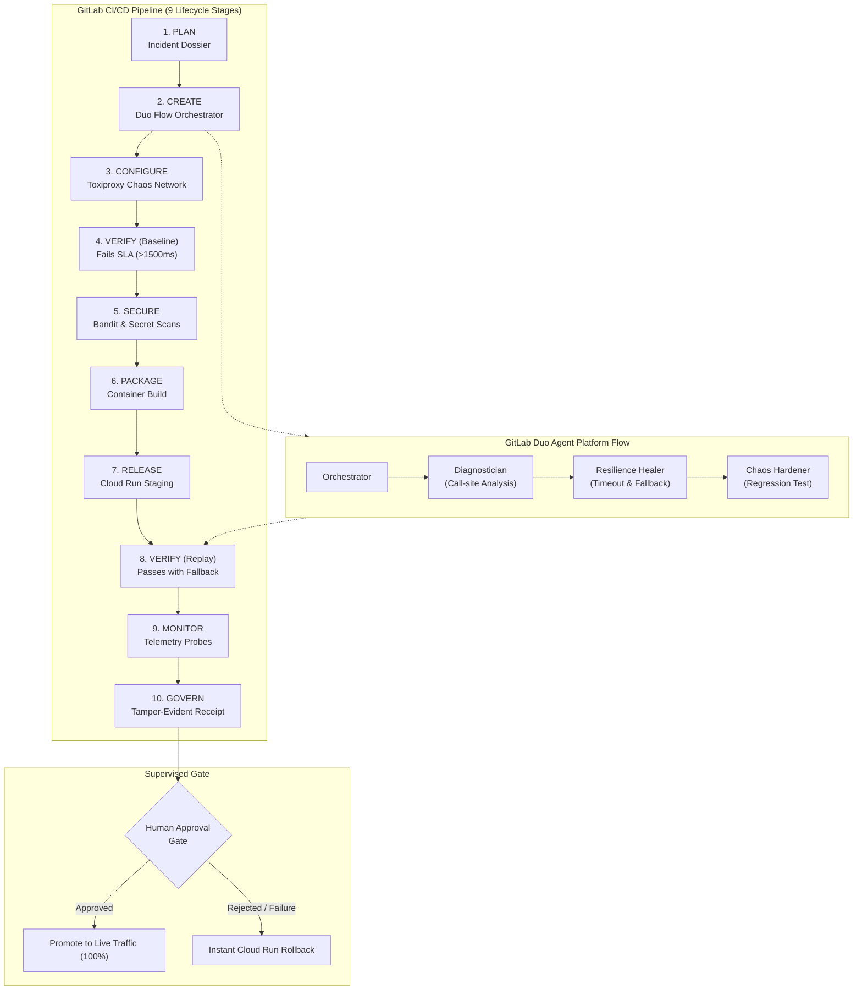

# FaultForge — Break It, Heal It

> **Rehearse a failure. Recover safely. Prove the service is stronger.**  
> Built for the **GitLab Transcend 2026: Life After Code** Hackathon.

> [!NOTE]
> **Status: Work in Progress.** Undergoing rigorous verification and completion audit across Phases 0–14 to replace all placeholders with verifiable implementations.

[](LICENSE)
[](flows/faultforge-flow.yaml)
[](docs/safety-policy.md)
[](.gitlab-ci.yml)
[](infra/cloudrun/)

---

## 1. Executive Summary

Most CI pipelines only tell a developer that an ordinary unit test failed. Many AI coding agents can suggest a patch, but **cannot prove the patch withstands network-level degradation**. When external dependencies slow down, reset connections, or experience transient outages, services fail silently in production due to thread starvation and missing fallbacks.

**FaultForge** connects controlled chaos testing, evidence-backed AI diagnosis, safe recovery, and empirical proof into an end-to-end engineering workflow:

1. **Inject Controlled Chaos:** Introduce a deterministic network delay (3500ms + 250ms jitter) into an isolated downstream dependency via Toxiproxy.
2. **Detect & Collect Evidence:** Record SLA budget breaches (>1500ms), capture sanitized logs, and compile a compact Incident Dossier.
3. **Diagnose via GitLab Duo:** Run an evidence-backed Diagnostician to locate the fragile call site without fabricating root-cause blame.
4. **Propose Scoped Remediation:** GitLab Duo Healer plans a minimal resilience fix: strict bounded timeouts, a circuit breaker, and a graceful fallback.
5. **Replay Identical Fault:** Re-run the **exact same Toxiproxy fault profile** against the candidate release.
6. **Empirical Proof:** Confirm that SLA breaches drop to zero, average latency drops by >60%, and the service returns an observable fallback.
7. **Supervised Autonomy Gate:** Enforce risk-based governance, generate a cryptographic SHA-256 Evidence Receipt, and require human review before live production promotion.

> **The Differentiator:** It is not "AI says it fixed the app." **It is the before/after empirical proof under the exact same controlled failure condition.**

---

## 2. End-to-End Workflow Architecture



---

## 3. The 9 Covered Lifecycle Stages

FaultForge implements real, testable operations with machine-readable artifacts across all **9 GitLab Lifecycle Stages**:

| Stage | FaultForge Action | Artifact / Evidence |
|---|---|---|
| **`plan`** | Compiles structured Incident Dossier with sanitized logs and failure metrics | [`reports/incident_dossier.json`](reports/incident_dossier.json) |
| **`create`** | GitLab Duo Flow plans resilience fix, generates MR description and risk assessment | [`reports/merge_request_payload.json`](reports/merge_request_payload.json) |
| **`configure`** | Configures Toxiproxy network chaos topology and latency toxic profiles | [`chaos/profiles/latency_cascading_hang.json`](chaos/profiles/latency_cascading_hang.json) |
| **`verify`** | Runs unit tests and executes before/after exact-fault replay proof | [`reports/replay_evaluation.json`](reports/replay_evaluation.json) |
| **`secure`** | Scans Python AST for vulnerabilities (Bandit) and strips credentials | [`reports/bandit_security_report.json`](reports/bandit_security_report.json) |
| **`package`** | Builds multi-stage production Docker container with non-root security user | [`Dockerfile`](Dockerfile) |
| **`release`** | Deploys candidate container revision to Google Cloud Run staging | [`infra/cloudrun/service.yaml`](infra/cloudrun/service.yaml) |
| **`monitor`** | Aggregates live sliding-window latencies (p50, p95, p99) and circuit breaker status | [`app/resilience/metrics.py`](app/resilience/metrics.py) |
| **`govern`** | Enforces Supervised Autonomy gate and signs tamper-evident SHA-256 seal | [`reports/EVIDENCE_RECEIPT.md`](reports/EVIDENCE_RECEIPT.md) |

---

## 4. Quickstart: Rehearse & Heal Locally

### Prerequisites
- Python 3.12+
- `pip install -r requirements.txt`

### Step 1: Run the Unit & Integration Tests
```bash
pytest tests/unit tests/integration -v
```

### Step 2: Demonstrate Baseline Vulnerability Under Chaos
Run the chaos experiment against the unpatched baseline service:
```bash
python scripts/run_fault.py --mode baseline --output reports/fault_run_baseline.json
```
*Expected Outcome:* Probes exceed the 1500ms SLA budget or timeout under the 3500ms Toxiproxy delay.

### Step 3: Ingest Evidence & Execute GitLab Duo Flow
Build the Incident Dossier and execute the Duo Flow Orchestrator:
```bash
python scripts/collect_evidence.py
python scripts/diagnose_and_bisect.py
python scripts/duo_orchestrator.py
```
*Output:* Diagnostician identifies unbounded HTTP call site at `app/clients/shipping_client.py:45` and generates Merge Request payload with **LOW** risk classification.

### Step 4: Replay the Exact Same Fault Against Hardened Version
Replay the identical Toxiproxy profile hash against the hardened service:
```bash
python scripts/run_fault.py --mode hardened --output reports/fault_run_hardened.json
python scripts/evaluate_replay.py --baseline reports/fault_run_baseline.json --hardened reports/fault_run_hardened.json
```
*Expected Outcome:* SLA breaches drop from 5 to 0. Average latency drops by >60%. Service returns deterministic fallback quote with `"is_fallback": true`. Status: `RECOVERED_AND_VERIFIED`.

### Step 5: Generate Tamper-Evident Evidence Receipt
```bash
python scripts/generate_receipt.py
cat reports/EVIDENCE_RECEIPT.md
```

---

## 5. Hackathon Prize Strategy & Compliance

- **Track:** Path B — Bring Your Own (Valid MIT License).
- **Primary Category:** **Best Supervised Agent ($4,000)**. Full automation for investigation, MR preparation, and staging checks, with an explicit human approval gate for live traffic promotion.
- **Secondary Category:** **Most Stages Covered ($5,000)**. All 9 lifecycle stages actively verified with machine-readable outputs.
- **Additional Category:** **Most Creative ($4,000)**. First-of-its-kind "Break It, Heal It" loop with exact-fault replay verification.
- **Google Cloud Bonus:** Google Cloud Run Knative deployment and traffic management code committed in [`infra/cloudrun/`](infra/cloudrun/).

---

## 6. License

This project is licensed under the terms of the [MIT License](LICENSE).
