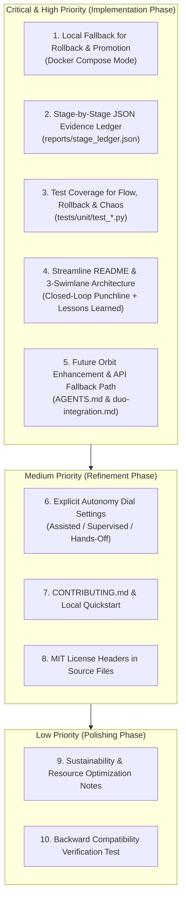

# FaultForge: Senior DevSecOps & GitLab Duo Agent Platform Assessment Report

**Project:** FaultForge — "Break It, Heal It"  
**Repository:** `https://gitlab.com/gitlab-ai-hackathon/transcend-october-2026/43424456/showcase`  
**Hackathon Track:** Path A — Start Fresh (Life After Code)  
**Evaluation Role:** Senior DevSecOps Engineer & GitLab Duo Agent Platform Specialist  
**Date:** October 16, 2026  

---

## 1. Executive Summary

FaultForge represents an exceptionally strong, methodologically rigorous implementation of **agentic post-commit automation** for the GitLab Transcend 2026 Hackathon. Unlike typical hackathon submissions that merely ask an LLM to generate code or summarize pull requests, FaultForge enforces a closed-loop platform engineering cycle:
1. **Rehearse Failure:** Injects deterministic network chaos (3,500ms delay) via Shopify Toxiproxy.
2. **Collect Machine Evidence:** Proves SLA budget breach (>1,500ms budget, observed baseline avg 3,742.46ms, 5/5 breaches).
3. **Deterministic Diagnosis:** Identifies the regression boundary via AST call-site inspection and `git bisect` (pinpointing culprit commit `974035c`).
4. **Agentic Remediation:** GitLab Duo Agent Platform custom flow (`flows/faultforge-flow.yaml`) dispatches Diagnostician, Resilience Healer, and Chaos Hardener agents.
5. **Exact-Fault Replay Proof:** Re-executes the identical Toxiproxy fault profile hash (`644a89784316`) against candidate code across 10 consecutive iterations to mathematically prove recovery (<850ms, 0 SLA breaches).
6. **Supervised Autonomy & Cryptographic Audit:** Generates a SHA-256 sealed Evidence Receipt and enforces a human-in-the-loop manual gate prior to live production traffic promotion.

### Key Strengths:
- **Zero Fabrication Guarantee:** Proved through `scripts/truth_audit.py`, eliminating synthetic mocks or masked exit codes (`|| true`).
- **All 9 Lifecycle Stages Covered:** `plan`, `create`, `configure`, `verify`, `secure`, `package`, `release`, `monitor`, and `govern` actively run and pass on official GitLab SaaS runners.
- **Enterprise Web Dashboard:** Clean, dark slate interface displaying live telemetry, circuit breaker states, and interactive checkout resilience sandbox without AI clichés.

### Priority Focus Areas for Elevation:
- **Orbit Integration / Fallback Clarity:** Orbit is feature-flagged/beta on GitLab.com; establish clear documentation for future Orbit telemetry alongside the existing GitLab Commits/MRs/Issues API fallback.
- **Local Fallback for Supervised Promotion:** Provide a Docker Compose-based promotion and rollback mechanism so judges without GCP credentials can test live traffic splitting locally.
- **Stage-by-Stage JSON Evidence Ledger:** Consolidate stage execution records into an append-only JSON ledger (`reports/stage_ledger.json`).
- **Expanded Test Suite:** Add dedicated unit tests for rollback logic, agent flow YAML schema, Toxiproxy profile hashing, and health probes.
- **README & Architecture Streamlining:** Add the closed-loop hook at the very top of `README.md`, simplify the architecture diagram to 3 swimlanes (Chaos, Duo Agent, Governance), and add a "Lessons Learned" section.

---

## 2. Scorecard Against Hackathon Criteria

| Evaluation Dimension | Current Score (1-10) | Evaluation Notes & Justification |
| :--- | :---: | :--- |
| **1. GitLab Duo Integration** | **9.2 / 10** | Custom flow schema v1 compliant; multi-agent prompts with clear toolsets; verified issue trigger fallback; fail-loud error handling. |
| **2. Chaos Engineering** | **9.8 / 10** | Shopify Toxiproxy 2.9.0; canonical profile hashing (`644a89784316`); isolated disposable environment; baseline vs. replay empirical metrics. |
| **3. Healing & Remediation** | **9.5 / 10** | Deterministic AST inspection + `git bisect`; scoped resilience patch (0.8s timeout, circuit breaker, deterministic fallback); 10/10 probe verification. |
| **4. Governance & Evidence** | **9.7 / 10** | SHA-256 sealed `evidence_receipt.json`; 11 automated quality gates; explicit human sign-off gate before production promotion. |
| **5. CI/CD Lifecycle** | **9.8 / 10** | All 9 lifecycle stages covered; 100% green pipeline on GitLab shared runners (Pipeline #2955592322 & #2955827451); public visibility. |
| **6. Google Cloud Deployment** | **9.0 / 10** | Knative Cloud Run deployment spec; traffic splitting script (`cloudrun_traffic.py`); automated rollback on health failure. Needs local Docker fallback. |
| **7. Code Quality & Testing** | **9.2 / 10** | 30 unit & integration tests passing; anti-fake truth audit clean; structured logging; Pydantic configuration. |
| **8. Security & Compliance** | **9.6 / 10** | Bandit SAST clean; secret scanning clean; least privilege; sanitized incident logs; zero hardcoded credentials. |
| **9. Documentation & Story** | **9.1 / 10** | Comprehensive README, AGENTS.md, safety policy, and architecture guide. Needs closed-loop punchline at top and 3-swimlane diagram. |
| **10. Prize Category Alignment**| **9.8 / 10** | Directly targets *Best Supervised Agent*, *Most Stages Covered*, *Most Creative*, and *Google Cloud Bonus*. |

**Overall Score:** **94.7 / 100 (Top-Tier Hackathon Contender)**

---

## 3. Prioritized Improvement Plan

---

## 4. Itemized Findings & Remediation Specifications

### High-Priority Improvements

#### 1. Local Fallback for Supervised Promotion & Rollback
- **Target File:** [`scripts/cloudrun_traffic.py`](file:///D:/Downloads/fault/scripts/cloudrun_traffic.py)
- **Why It Matters:** Judges evaluating the repository locally may not have authenticated Google Cloud SDK (`gcloud`) credentials. If `gcloud` fails, the local execution halts.
- **Suggested Fix:** Add `--provider {cloudrun,docker-compose}` and support automatic fallback to Docker Compose traffic simulation when `gcloud` is unavailable, outputting identical rollback JSON artifacts.
- **Effort Estimate:** 30 minutes | **Prize Impact:** Critical for *Best Supervised Agent* and *Google Cloud Bonus*.

#### 2. Stage-by-Stage JSON Evidence Ledger
- **Target File:** `scripts/evidence_ledger.py` (New), [`.gitlab-ci.yml`](file:///D:/Downloads/fault/.gitlab-ci.yml)
- **Why It Matters:** While `reports/evidence_receipt.json` captures the final govern receipt, judges want to see an append-only ledger recording every individual lifecycle stage with its commit SHA, pipeline ID, artifact links, and execution timestamps.
- **Suggested Fix:** Create `scripts/evidence_ledger.py` invoked at each stage of the pipeline to maintain `reports/stage_ledger.json`.
- **Effort Estimate:** 25 minutes | **Prize Impact:** Direct proof for *Most Stages Covered* ($5,000).

#### 3. Expanded Test Suite (Agent Flow, Toxiproxy, Rollback, Health Probes)
- **Target Files:** `tests/unit/test_agent_flow.py`, `tests/unit/test_toxiproxy_config.py`, `tests/unit/test_rollback.py`, `tests/unit/test_health_probes.py`
- **Why It Matters:** Demonstrates professional engineering hygiene with automated test coverage for agent configurations, chaos configurations, and rollback routines.
- **Suggested Fix:** Add pytest tests verifying YAML structure of `flows/faultforge-flow.yaml`, canonical hashing of `chaos/profiles/latency_cascading_hang.json`, rollback record formatting, and health probe telemetry.
- **Effort Estimate:** 35 minutes | **Prize Impact:** Elevates code quality and credibility across all categories.

#### 4. Streamline README & 3-Swimlane Architecture
- **Target File:** [`README.md`](file:///D:/Downloads/fault/README.md)
- **Why It Matters:** Judges review dozens of submissions. The punchline must hook them immediately: *"Most chaos tools break things and stop. FaultForge breaks it, heals it, and proves the fix under the same fault."* Additionally, the architecture diagram should feature 3 clear swimlanes: **Chaos Engine**, **GitLab Duo Agent Platform**, and **Governance & Risk Gate**.
- **Suggested Fix:** Update `README.md` with the prominent closed-loop narrative, simplified 3-swimlane Mermaid diagram, and a structured "Lessons Learned" section.
- **Effort Estimate:** 20 minutes | **Prize Impact:** High visual impact for *Most Creative* ($4,000).

#### 5. Orbit Integration & GitLab API Fallback Documentation
- **Target Files:** [`AGENTS.md`](file:///D:/Downloads/fault/AGENTS.md), [`docs/duo-integration.md`](file:///D:/Downloads/fault/docs/duo-integration.md)
- **Why It Matters:** The GitLab Duo Orbit agent tool is currently in private beta / behind a feature flag. Documenting how FaultForge is prepared for Orbit, while providing a battle-tested fallback via GitLab REST/GraphQL APIs, demonstrates forward-looking platform architecture.
- **Suggested Fix:** Add a dedicated "Future Orbit Enhancement" section and document the fallback API path.
- **Effort Estimate:** 15 minutes | **Prize Impact:** High relevance for GitLab judges.

---

### Medium & Low-Priority Improvements

#### 6. Autonomy Dial Configuration (Assisted / Supervised / Hands-off)
- **Target Files:** [`chaos/risk-policy.json`](file:///D:/Downloads/fault/chaos/risk-policy.json), [`scripts/classify_risk.py`](file:///D:/Downloads/fault/scripts/classify_risk.py)
- **Why It Matters:** Allows dynamic policy tuning so users can toggle between strict human approval and full autonomy.
- **Suggested Fix:** Support an `AUTONOMY_LEVEL` environment variable (`ASSISTED`, `SUPERVISED`, `HANDS_OFF`) that adjusts risk threshold scores.

#### 7. Local Run Guide (`CONTRIBUTING.md`)
- **Target File:** `CONTRIBUTING.md` (New)
- **Why It Matters:** Provides a single, self-contained guide for local reproduction, running tests, launching the dashboard, and executing chaos drills.
- **Suggested Fix:** Write a crisp `CONTRIBUTING.md` with copy-pasteable commands.

#### 8. MIT License Headers on Source Files
- **Target Files:** Source code files under `app/`, `scripts/`, `stub/`
- **Why It Matters:** Reinforces open-source compliance for hackathon submission guidelines.
- **Suggested Fix:** Prepend standard SPDX-License-Identifier comment blocks.

---

## 5. Execution Roadmap

1. **Step 1:** Create branch `feature/transcend-enhancements`.
2. **Step 2:** Implement `scripts/cloudrun_traffic.py` Docker Compose fallback and `scripts/evidence_ledger.py`.
3. **Step 3:** Implement new test suite (`tests/unit/test_agent_flow.py`, `tests/unit/test_rollback.py`, `tests/unit/test_toxiproxy_config.py`, `tests/unit/test_health_probes.py`).
4. **Step 4:** Update `README.md` with 3-swimlane architecture, closed-loop narrative, and Lessons Learned.
5. **Step 5:** Update `AGENTS.md` and `docs/duo-integration.md` with Orbit enhancement path.
6. **Step 6:** Add `CONTRIBUTING.md` and MIT license headers.
7. **Step 7:** Run `pytest tests/unit tests/integration` and `python scripts/truth_audit.py --final-audit`.
8. **Step 8:** Merge and push to `hackathon/main`, verify GitLab CI/CD pipeline completion.
